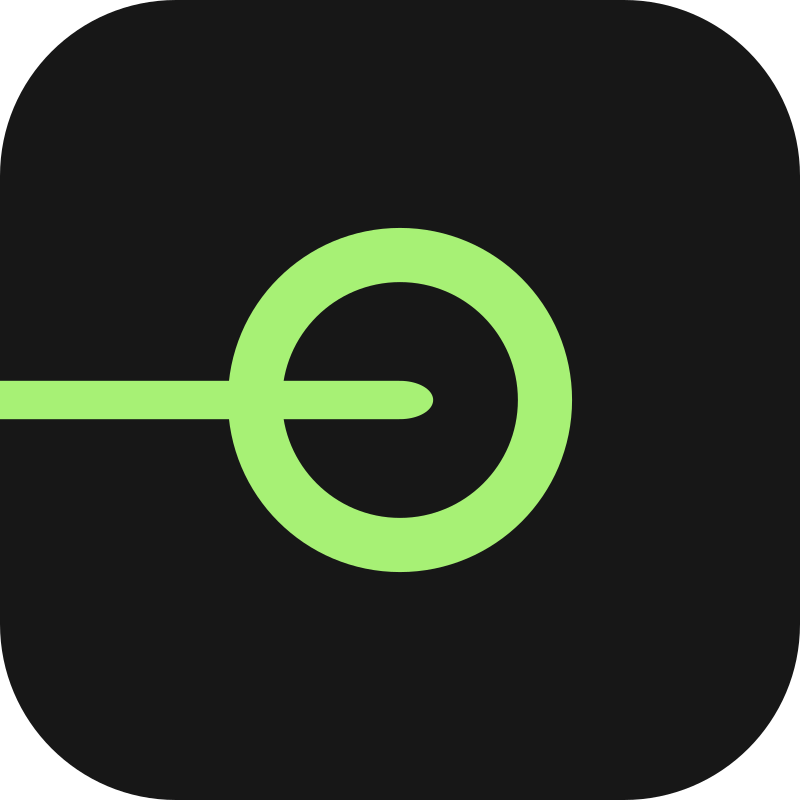

# bitmancer

Building digital stuff at the intersection of design, code, music and art.

[Gumroad](https://bitmancer.gumroad.com/) · [YouTube](https://www.youtube.com/@bitmancer_) · [bitmancer@wndrbr.de](mailto:bitmancer@wndrbr.de)

---

## Projects

<table>
  <tr>
    <td width="76" valign="middle"></td>
    <td valign="middle">
      <strong><a href="https://radiodock.app">RadioDock</a></strong> · <a href="https://github.com/bitm4ncer/radiodock.app">GitHub</a> 
      Internet radio wherever you are: an installable PWA, native apps for Windows, macOS and Linux, and a Chrome extension. 50,000+ stations, no account, no ads, no tracking.
    </td>
  </tr>
  <tr>
    <td width="76" valign="middle"></td>
    <td valign="middle">
      <strong><a href="https://bitmancer.gumroad.com/l/toolbridge-complete">Toolbridge</a></strong> 
      Standalone image editor and <a href="https://www.affinity.studio">Affinity</a> 3 extension: pull a layer in, run it through Input, AI, Field, Film Grain emulation, Glitch, Dither and Texture, and send it back.
    </td>
  </tr>
  <tr>
    <td width="76" valign="middle"></td>
    <td valign="middle">
      <strong><a href="https://bitm4ncer.github.io/hustl/">Hustl</a></strong> · <a href="https://github.com/bitm4ncer/hustl">GitHub</a> 
      Invoices, offers and finances for freelancers, solo self-employed people, musicians, artists and other independent creatives. Self-hosted on your own server. German e-invoicing (ZUGFeRD/Factur-X). No cloud, no telemetry.
    </td>
  </tr>
  <tr>
    <td width="76" valign="middle"></td>
    <td valign="middle">
      <strong><a href="https://clipmark.de">Clipmark</a></strong> 
      Branded profile-picture generators for conferences and companies. Participants create a matching avatar in seconds, and the client never has to edit anything.
    </td>
  </tr>
  <tr>
    <td width="76" valign="middle"></td>
    <td valign="middle">
      <strong><a href="https://bitm4ncer.github.io/UnseenStream/">Unseen</a></strong> · <a href="https://github.com/bitm4ncer/UnseenStream">GitHub</a> 
      A feed of random YouTube videos no one has ever watched.
    </td>
  </tr>
</table>

## WIP

- **[Magpie](https://magpie-theme.com)** — Portfolio theme and page builder for Kirby: modular content blocks, a shared media library, and everything editable from the panel.
- **[Biosphere One](https://github.com/bitm4ncer/biosphere_one)** — A live satellite map in the browser: Sentinel-2, night lights, daily cloud cover, and a timeline over a year of imagery. No backend.
- **[scatalog](https://github.com/bitm4ncer/scatalog)** — Chrome extension for browsing complete label catalogs on Spotify, with related artists and the other labels they're on.
- **[slammer.app](https://slammer.app)** — Browser-native multi-layer image editor with non-destructive effect stacks and VST-like plugins.
- **[orbitrack](https://orbitrack.app)** — Polyrhythmic step sequencer on a circular grid, with a synth, samples and an effects chain per orbit.
- **[SkinSpace](https://github.com/bitm4ncer/SkinSpace)** — Classic Windows Media Player skins and visualizers, ported to VLC. Fan project, starting with Headspace.
- **[CSVM Starter](https://github.com/bitm4ncer/crimson-skies-csvm-starter)** — One-click Windows setup for CSVM, the open-source Crimson Skies (2000) remake.
- **[VideoWizard](https://github.com/bitm4ncer/VideoWizard)** — An agent suite that plans and produces videos, shorts and tutorials, from transcript and voiceover to the final cut.

---

More repositories: [github.com/bitm4ncer?tab=repositories](https://github.com/bitm4ncer?tab=repositories)
